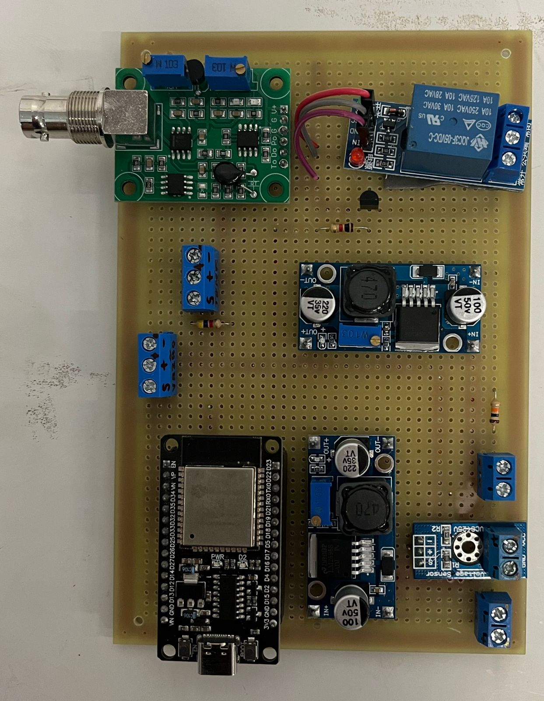
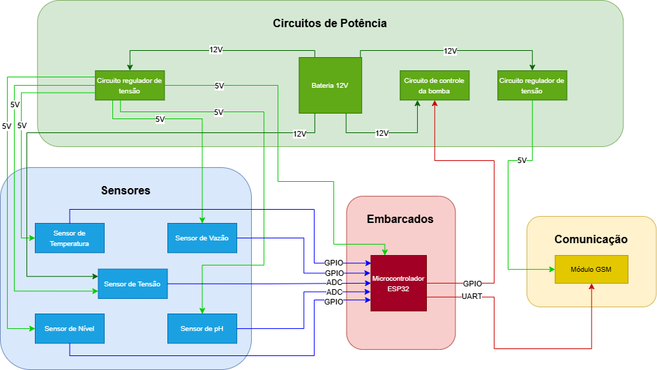
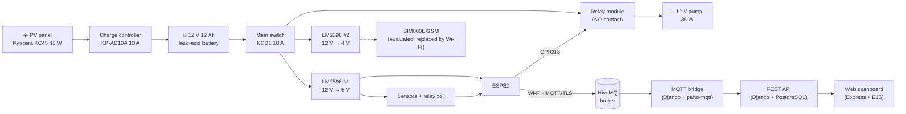
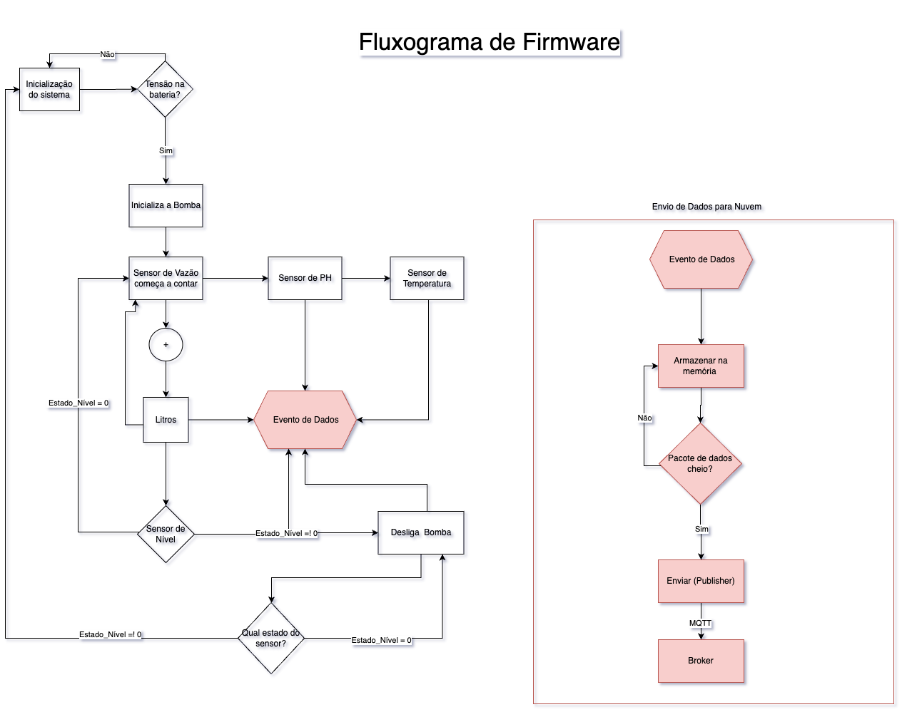
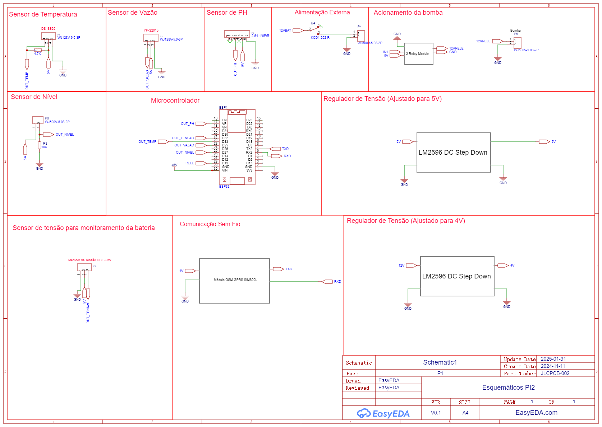
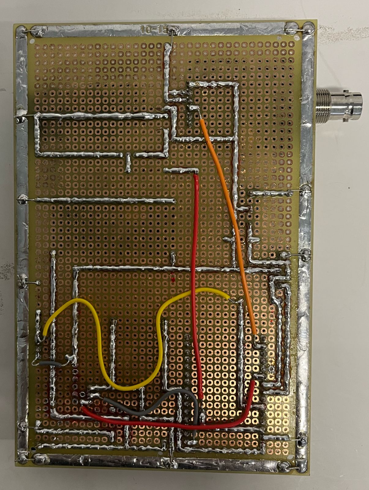
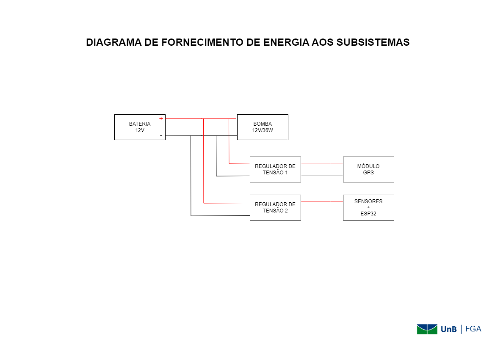
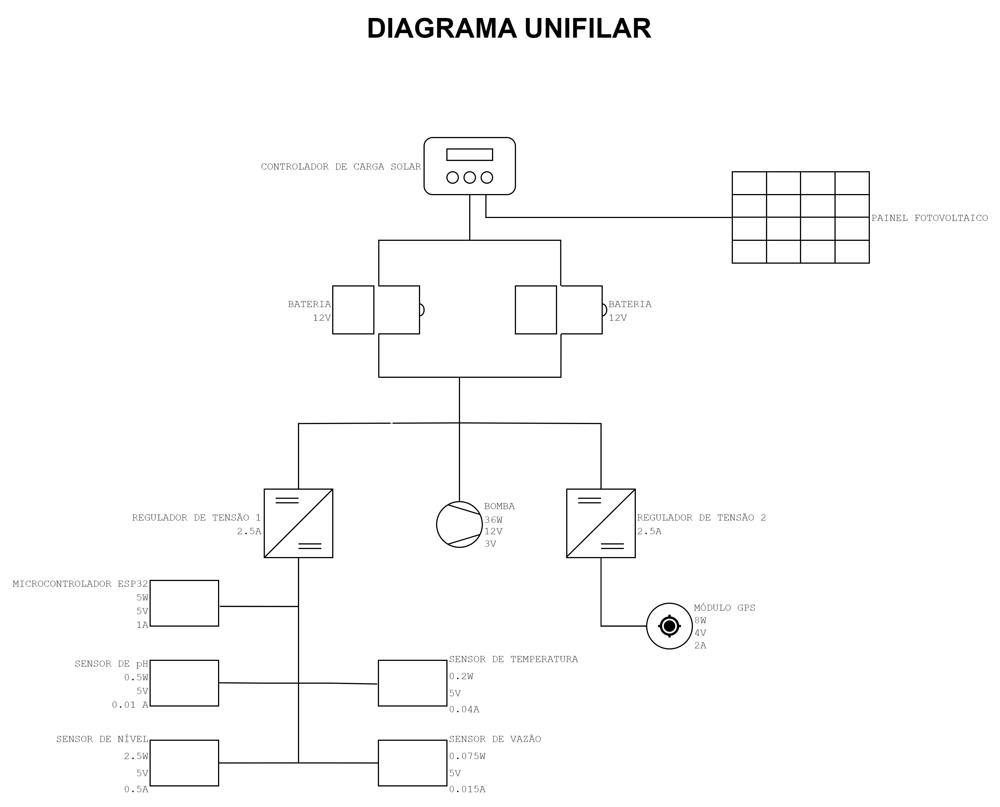

# Solar Banyu: Solar-Powered Water Desalination with IoT Monitoring

> **Embedded electronics · Sensor conditioning · Off-grid power · IoT telemetry**

Solar Banyu is an off-grid reverse-osmosis desalination prototype. A 45 W solar panel and a 12 V battery power it. An **ESP32** monitors water quality (pH, temperature, flow, tank level) and battery voltage, and switches the 12 V pump through a relay. It sends its readings over **MQTT** to a cloud dashboard.

The project was developed by a multidisciplinary team of 19 students (Software, Electronics, Energy and Structures) in the *Projeto Integrador de Engenharia 2* course at the **University of Brasília (UnB, FCTE / Gama campus)**, semester 2024.2. **I was the Electronics Lead.** I was responsible for the electronic architecture, sensor selection and the bill of materials, the schematics, the sensor bring-up and calibration firmware, and the perfboard integration.

<p align="center">
  
  
</p>

📄 Full project documentation (Portuguese): <https://documentacao-relatorio-2d8035.gitlab.io/>

---

## Table of contents
1. [Project summary](#project-summary)
2. [How it works](#how-it-works)
3. [Electronics](#electronics)
4. [Power system](#power-system)
5. [Firmware](#firmware)
6. [Software stack](#software-stack)
7. [Running locally](#running-locally)
8. [Validation and test results](#validation-and-test-results)
9. [Repository structure](#repository-structure)
10. [Team and credits](#team-and-credits)

---

## Project summary

| | |
|---|---|
| **Goal** | Produce drinking water from brackish or saline water using only solar energy, with remote monitoring of water quality and system health |
| **Water treatment** | Polypropylene sediment filter → activated carbon → mixed-bed resin → reverse-osmosis membrane |
| **Controller** | ESP32 DevKit (Wi-Fi, 12-bit ADC, hardware interrupts) |
| **Sensors** | pH (PH-4502C), temperature (DS18B20), flow (YF-S201), float level switch, battery voltage divider (0–25 V) |
| **Actuation** | 5 V opto-isolated relay module switching the 12 V / 36 W pump |
| **Power** | Kyocera KC45 45 W PV panel → 10 A charge controller → 12 V 12 Ah battery → 2 × LM2596 buck converters |
| **Telemetry** | MQTT over TLS (HiveMQ Cloud) → Python MQTT bridge → Django REST API + PostgreSQL → Node.js/Express dashboard |
| **Board** | Hand-wired perfboard with screw terminals for every field sensor (schematic drawn in EasyEDA) |

---

## How it works



1. **Energy harvesting.** The PV panel charges the 12 V battery through the charge controller. The whole system is DC, with no inverter.
2. **Power conditioning.** Two LM2596 step-down converters create the low-voltage rails from the battery. The pump is the only load that runs directly from 12 V.
3. **Sensing.** The ESP32 continuously reads:
   * **pH**: analog voltage, 20 samples averaged per reading
   * **Water temperature**: DS18B20 on a 1-Wire bus, in a 10-sample circular buffer (one sample every 0.5 s)
   * **Flow / produced volume**: YF-S201 pulses counted by a hardware interrupt (`IRAM_ATTR` ISR)
   * **Tank level**: float switch on a digital input
   * **Battery voltage**: resistive divider on an ADC1 input
4. **Control.** When the float switch says the product-water tank is full, the relay opens and the pump stops. When the level drops, the pump restarts.
5. **Telemetry.** Every 10 s the firmware packs all readings into a JSON array and publishes it to the `solarbanyu/sensors/values` topic over TLS (port 8883).
6. **Back end.** An MQTT bridge subscribes to the topic, attaches units, stores each value through the REST API and raises **alerts**. Alerts fire for a sensor reading ≤ 0, a temperature above 50 °C, a pH outside the 5–8 range, or a failed write to the API.
7. **Dashboard.** Users log in to see live values, history charts, alerts and reports.

<p align="center"></p>

---

## Electronics

### Schematic



*The schematic was drawn in EasyEDA (v5). Sheet sections, left to right and top to bottom: temperature sensor, flow sensor, pH sensor, external power input, pump drive, level sensor, microcontroller, 5 V regulator, battery voltage sensor, wireless (GSM) communication, 4 V regulator.*

### Assembled board

| Front (components) | Back (wiring) |
|---|---|
|  |  |

The circuit was built on a perforated board. Every module (ESP32, pH front end, relay, both buck converters and the voltage sensor) sits on headers. All field wiring goes to KRE screw terminals, so sensors and the pump can be swapped without soldering. Each track was continuity-tested before power-up, and each subsystem was then validated on its own.

### ESP32 pin map

| Signal | ESP32 GPIO | Type | Notes |
|---|---|---|---|
| pH sensor (`Po`) | **GPIO36** (VP) | ADC1, input-only | 20-sample average; ADC1 keeps working while Wi-Fi is active |
| Battery voltage | **GPIO32** | ADC1 | 30 kΩ / 7.5 kΩ divider (÷5) |
| DS18B20 data | **GPIO33** | 1-Wire | 4.7 kΩ pull-up to 5 V (R8) |
| YF-S201 flow | **GPIO25** | Digital, interrupt (rising edge) | Hall-effect pulse output |
| Float level switch | **GPIO27** | Digital input | 10 kΩ pull-down (R3) |
| Pump relay `IN1` | **GPIO13** | Digital output | Drives the opto-isolated relay input |
| SIM800L TX/RX | UART2 (TX2/RX2) | UART | Prototype only, see the design decisions below |

> Analog sensors are deliberately placed on **ADC1** pins. ADC2 cannot be used while the ESP32 Wi-Fi radio is on.

### Bill of materials (electronics)

| Ref | Component | Key specs | Role |
|---|---|---|---|
| U3 | ESP32 DevKit (ESP32-WROOM-32) | Dual-core, Wi-Fi + BLE, 12-bit SAR ADC | Main controller |
| — | PH-4502C + BNC glass probe | 5 V supply, pH 0–14, analog `Po` output, offset trimpots | Water acidity |
| — | DS18B20 waterproof probe | −55…+125 °C, ±0.5 °C, 9–12 bit, 1-Wire | Water temperature |
| — | YF-S201 (G1/2") | 1–30 L/min, 4.5–18 V, Hall-effect pulse output | Flow and produced volume |
| — | Horizontal float switch (11 mm) | Magnetic reed, 100 V DC / 0.5 A | Product-tank level |
| — | DC voltage sensor 0–25 V | 30 kΩ + 7.5 kΩ divider (5:1), 1 % | Battery state of charge |
| — | Relay module, 5 V, opto-isolated | 10 A @ 250 VAC / 30 VDC contacts | Pump on/off (NO contact) |
| — | 2 × LM2596 buck module | 3.2–40 V in, 1.5–35 V out, up to ~2.5 A, ~92 % efficiency | 5 V and 4 V rails |
| — | SIM800L GSM/GPRS | Quad-band 2G, 3.7–4.2 V, UART AT commands | Long-range link (evaluated) |
| U4 | KCD1 rocker switch | 10 A | Main power switch |
| R3 | 10 kΩ ¼ W | — | Level-switch pull-down |
| R8 | 4.7 kΩ ¼ W | — | 1-Wire pull-up |
| P1, P2, P5–P7 | KRE 5.08 mm screw terminals (2- and 3-way) | — | Field connections |

Datasheets for every active component are in [`hardware/datasheets/`](hardware/datasheets).

### Key design decisions

* **Relay instead of driving the pump directly.** The pump draws about 3 A at 12 V, and a 3.3 V GPIO cannot switch that. The opto-isolated relay module separates the noisy inductive load from the MCU ground.
* **Split regulators.** The SIM800L can draw current bursts of up to about 2 A during GSM transmission. These bursts would brown out the ESP32 on a shared rail. The modem therefore got its own LM2596 set to 4 V, inside its 3.7–4.2 V window. The second LM2596 supplies a clean 5 V rail for the MCU, sensors and relay coil.
* **GSM → Wi-Fi.** The SIM800L was tested first, for deployment far from Wi-Fi. It could not hold a stable TLS/MQTT session with the broker because of low 2G bandwidth and frequent drops. The final firmware uses the ESP32's own Wi-Fi. The 4 V rail and UART footprint were kept on the board so the GSM link can be added back later.
* **Voltage-divider range.** The ÷5 divider maps up to 16.5 V onto the 3.3 V ADC range. That covers a 12 V lead-acid battery during charging (about 14.4 V), with margin.
* **Noise handling.** pH readings are averaged over 20 samples. Temperature uses a 10-sample moving average. The battery reading is averaged in software because the ESP32 ADC is noisy and non-linear near its rails.

### Sensor conversions (from the firmware)

| Quantity | Conversion |
|---|---|
| pH | `V = ADC/4095 · 3.3` → `pH = 7 + (2.5 − V) / 0.18`. The probe outputs about 2.5 V at pH 7, with a slope of about −0.18 V/pH, calibrated with pH 4.0 and pH 7.0 buffers. |
| Battery voltage | `V_bat = ADC/4095 · V_ref,cal · (30 k + 7.5 k)/7.5 k`. `V_ref,cal` was trimmed against a bench supply to correct the ESP32 ADC gain error. |
| Flow | `Q [L/min] = pulses / 4.78`. The calibration factor was found experimentally for the 5 V supply. |
| Temperature | Native DS18B20 digital reading (°C), averaged over 10 samples |

---

## Power system

| Item | Value |
|---|---|
| Load budget | pH 0.5 W · level 2.5 W · temperature 0.2 W · flow 0.075 W · ESP32 5 W · GSM 8 W · pump 36 W → **51.8 W** |
| Energy per cycle | 129.6 Wh per 2.5 h cycle (about 20 L of water). Including 92 % regulator efficiency: **138.9 Wh** |
| Solar resource | Brasília, 5.37 kWh/m²/day (CRESESB) |
| PV panel | Kyocera KC45: 45 W, V<sub>mp</sub> 15.0 V, I<sub>mp</sub> 3.0 A, V<sub>oc</sub> 19.2 V. Minimum required power was 32.3 W, so one panel is enough. |
| Battery | GetPower GP12-12: 12 V, 12 Ah lead-acid. Required capacity was 11.9 Ah, at 30 % depth of discharge and 90 % efficiency. |
| Charge controller | Knup KP-AD10A: 12/24 V, 10 A. Sized at 125 % of the panel I<sub>sc</sub>. |
| Wiring | Sized per ABNT NBR 5410 for 12.1 A (0.75 mm² required). 1.5 mm² cable was used. |

| Power distribution | Single-line diagram |
|---|---|
|  |  |

---

## Firmware

The firmware lives in [`firmware/`](firmware). It is written in Arduino C++ for the ESP32.

| Sketch | Purpose |
|---|---|
| [`solar_banyu_esp32/`](firmware/solar_banyu_esp32) | **Final integrated firmware**: all sensors, pump control, Wi-Fi + MQTT/TLS publishing |
| [`sensor_tests/`](firmware/sensor_tests) | Stand-alone bring-up and calibration sketches, one per sensor (pH, temperature, flow, level, battery voltage) |
| [`mqtt_communication_test/`](firmware/mqtt_communication_test) | Minimal Wi-Fi → HiveMQ publishing test |

The published MQTT payload, sent every 10 s:

```json
[
  {"tipo": "TEMPERATURA_AGUA", "valor": 25.69},
  {"tipo": "PH_AGUA",          "valor": 6.10},
  {"tipo": "NIVEL_AGUA",       "valor": 1},
  {"tipo": "TENSAO",           "valor": 12.80},
  {"tipo": "FLUXO_AGUA",       "valor": 3.56}
]
```

---

## Software stack

The software squad built the cloud side. It is included here so the full system can run end to end.

| Service | Tech | Port | Folder |
|---|---|---|---|
| REST API | Python 3.11, Django 5, Django REST Framework | 8000 | [`software/backend`](software/backend) |
| Database | PostgreSQL 13 (+ pgAdmin) | 5432 / 8080 | defined in `docker-compose.yml` |
| MQTT bridge | Django + paho-mqtt, subscribes to HiveMQ and posts to the API | 5000 | [`software/mqtt-bridge`](software/mqtt-bridge) |
| Dashboard | Node.js 18, Express, EJS | 3000 | [`software/frontend`](software/frontend) |

---

## Running locally

### 1. Firmware (ESP32)

**Requirements**
* [Arduino IDE 2.x](https://www.arduino.cc/en/software), or `arduino-cli`
* ESP32 board package by Espressif. Add `https://raw.githubusercontent.com/espressif/arduino-esp32/gh-pages/package_esp32_index.json` under *Boards Manager URLs*.
* Libraries (Library Manager): **OneWire**, **DallasTemperature**, **PubSubClient**, **ArduinoJson (v6.x)**
* A free [HiveMQ Cloud](https://www.hivemq.com/mqtt/) cluster, or any MQTT broker with TLS on port 8883

**Steps**
1. Create the credentials file:
   ```powershell
   Copy-Item firmware\solar_banyu_esp32\secrets.example.h firmware\solar_banyu_esp32\secrets.h
   ```
2. Edit `secrets.h` with your Wi-Fi SSID and password and your broker host, user and password. `secrets.h` is git-ignored.
3. Open `firmware/solar_banyu_esp32/solar_banyu_esp32.ino`, choose **ESP32 Dev Module**, select the COM port and click **Upload**.
4. Open the Serial Monitor at **115200 baud** to watch the sensor readings and MQTT publish status.

With `arduino-cli`:
```powershell
arduino-cli core install esp32:esp32
arduino-cli lib install OneWire DallasTemperature PubSubClient "ArduinoJson@6.21.5"
arduino-cli compile --fqbn esp32:esp32:esp32 firmware/solar_banyu_esp32
arduino-cli upload  --fqbn esp32:esp32:esp32 -p COM3 firmware/solar_banyu_esp32
```

> 💡 To bring up the board one sensor at a time, flash the sketches in `firmware/sensor_tests/` first. Each one prints raw and converted values to the serial port.

### 2. Back end and dashboard (Docker)

**Requirements:** [Docker Desktop](https://www.docker.com/products/docker-desktop/) with Docker Compose.

1. Create the shared Docker network:
   ```powershell
   docker network create app-network
   ```
2. Create the environment files from the templates, then edit the values:
   ```powershell
   Copy-Item software\backend\.env_example software\backend\.env
   ```
   ```powershell
   Copy-Item software\mqtt-bridge\.env.example software\mqtt-bridge\.env
   ```
   In `software/mqtt-bridge/.env`, set `BROKER_HOST`, `BROKER_USERNAME` and `BROKER_PASSWORD` to the same broker the ESP32 uses.
3. Build and start all services:
   ```powershell
   docker compose -f software/backend/docker-compose.yml up --build
   ```
4. Open:
   * Dashboard: <http://localhost:3000>
   * REST API: <http://localhost:8000/app/>, with the admin login from `DJANGO_SUPERUSER_*` in `.env`
   * MQTT bridge logs: <http://localhost:5000>
   * pgAdmin: <http://localhost:8080>

> **Note:** the dashboard's browser scripts point to the team's deployed API at `https://solarbanyu-backend.onrender.com`. To use only your local back end, replace that URL with `http://localhost:8000`:
> ```powershell
> Get-ChildItem software\frontend -Recurse -Include *.js -Exclude node_modules | ForEach-Object { (Get-Content $_.FullName) -replace 'https://solarbanyu-backend.onrender.com','http://localhost:8000' | Set-Content $_.FullName }
> ```
> The server-side `/monitoramento` route also reads an API token from the `API_TOKEN` environment variable.

### 3. Testing without hardware

You can feed the pipeline without an ESP32 by publishing a sample payload to the broker, for example with Mosquitto:

```powershell
mosquitto_pub -h <your-cluster>.hivemq.cloud -p 8883 -u <user> -P <password> --capath /etc/ssl/certs -t solarbanyu/sensors/values -m '[{"tipo":"TEMPERATURA_AGUA","valor":25.7},{"tipo":"PH_AGUA","valor":7.1},{"tipo":"NIVEL_AGUA","valor":1},{"tipo":"TENSAO","valor":12.8},{"tipo":"FLUXO_AGUA","valor":3.5}]'
```

---

## Validation and test results

| Test | Method | Result |
|---|---|---|
| **Flow sensor (YF-S201)** | Pump rated at 4 L/min filled a 500 mL bottle while the sensor was logged | Bottle filled in 7.80 s → **3.84 L/min measured** (−4 % vs. pump rating) |
| **pH sensor (PH-4502C)** | Two-point calibration with **pH 4.0 and pH 7.0 buffer solutions** in the FCTE chemistry lab, probe rinsed in distilled water, 3 min settling time | Offset and slope trimmed using the on-board trimpot |
| **Temperature (DS18B20)** | Compared against a reference kitchen thermometer | Calibrated and validated |
| **Battery voltage sensor** | 12 V / 10 A bench supply emulating the battery | ADC reference factor trimmed for correct reading |
| **Level switch** | Actuated the float manually and checked the logic level | Correct HIGH/LOW detection |
| **Relay module** | 12 V supply, switched every 10 s | Contact closure confirmed at each actuation |
| **GSM module (SIM800L)** | Attempted MQTT connection over GPRS | Unstable broker connection, so the design moved to ESP32 Wi-Fi |
| **Salinity (Daniell-cell method)** | Cu/Zn electrodes, measured potential in saline water (35 g/L) vs. tap water | 0.743–0.766 V (saline) vs. 0.681–0.712 V (tap). Used to set the maximum allowed salinity after filtration. |
| **Board integration** | Continuity test of every perfboard track, then per-subsystem power-up | All subsystems working on the integrated board |

Test videos are linked in the [electronics test-case page](https://documentacao-relatorio-2d8035.gitlab.io/) of the project documentation.

---

## Repository structure

```
Solar_Banyu/
├── firmware/
│   ├── solar_banyu_esp32/          # Final integrated ESP32 firmware
│   ├── sensor_tests/               # Per-sensor bring-up & calibration sketches
│   └── mqtt_communication_test/    # Wi-Fi + MQTT/TLS connectivity test
├── hardware/
│   ├── schematics/                 # Full schematic, block diagram, control flowchart
│   ├── board/                      # Photos of the assembled perfboard
│   ├── energy/                     # Power distribution & single-line diagrams
│   ├── components/                 # Component photos
│   └── datasheets/                 # Datasheets of all active components
└── software/
    ├── backend/                    # Django REST API + docker-compose for the full stack
    ├── mqtt-bridge/                # MQTT → REST bridge with alert rules
    └── frontend/                   # Express/EJS web dashboard
```

---

## Team and credits

Developed by **Squad 04**, Projeto Integrador de Engenharia 2, University of Brasília (UnB, FCTE), 2024.2.

* **Electronics Lead:** João Pedro Bandeira Raposo
* Electronics & energy: Matheus Alves, Flávia Nagata, Marjam Jodiwongso, Marcus Guimarães, Ana Carolina Monteiro (Energy Lead)
* Software: Mylena Angélica (Software Lead), Douglas Monteles, Bruno Vasconcelos, Yasmim Rosa, Sidney, Sebastian Zuzunaga, João Bisinotti, Victor Gonçalves
* Structures: Arthur Rodrigues (Structures Lead), Fillipe Leite, Giovanna Ayumi, Daniel Vieira

Original repositories (GitLab):
[source code](https://gitlab.com/unb-esw/fga-pi2/semestre-2024-3/squad04/codigos) ·
[documentation](https://gitlab.com/unb-esw/fga-pi2/semestre-2024-3/squad04/documentacao-relatorio)
